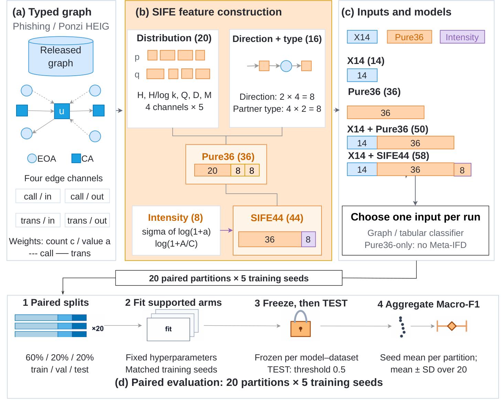

# SIFE44: Capturing Interaction Distributions for Ethereum Fraud Detection

Research artifact for the SIFE44/Pure36 manuscript by **Duy Loi Duong, Thanh Dat Tran, Duy Luu Hoang, Minh Huy Tran, and Nhat-Tung Le**, FPT University, Ho Chi Minh City, Vietnam.

This repository contains readable experiment notebooks, the underlying Python implementations, fixed configurations, compact frozen results, and analysis scripts for **Phish and Ponzi**. The five evaluated classifiers are **Meta-IFD, GAT, GraphSAGE, LightGBM, and Random Forest**.

SIFE44 describes the distribution, direction, counterparty composition, and intensity of typed incident records. Pure36 removes eight intensity descriptors. Its stated scale invariance is a descriptor-level property under specified rescaling with fixed topology and record support; it does **not** establish independence from transaction value or invariance of a classifier that also receives X14.



## Start here

| Goal | Instructions |
|---|---|
| Inspect the main numbers without training | Run `python code/analysis/reproduce_tables.py` |
| Replay exploratory activity matching from saved TEST predictions | Run `python code/analysis/reproduce_matching.py` |
| Check integrity, English notebook sources, and frozen code identities | Run `python code/verify_repository.py` |
| Train on the original graph inputs | Follow [Reproduction](docs/REPRODUCTION.md) and [Data](DATA.md) |
| Understand the comparison protocol | Read [Experimental protocol](docs/EXPERIMENTS.md) |
| Understand which checks were actually performed | Read [Validation](docs/VALIDATION.md) |

The table and matching replay paths need no blockchain download, Torch, GPU, fitted classifier checkpoint, or Kaggle account. Full training requires the original large graph inputs and the appropriate native graph-sampling environment.

## Repository layout

```text
code/
  experiments/
    main/                         # Ten standalone 20-partition notebooks and frozen source modules
    ablation/                     # Ten group-removal notebooks with their own full-input controls
    released_mask_reference/      # Ten X14 reference notebooks; kept separate from the main cohort
  analysis/                       # Table replay and frozen activity matching
  figures/                        # Statistical redraw scripts, separate from the supplied paper PDFs
  run_notebook.py                  # Command-line execution with explicit local input/output paths
  verify_repository.py            # Integrity and source checks using the Python standard library
configs/                          # Feature definitions, groups, study contract, recorded run configurations
results/
  main/                           # Per-fit metrics, 20-partition summaries, paired differences, TEST evidence
  ablation/                       # Metrics and group contributions from independently retrained controls
  activity_matching/              # Recorded matching, balance, coverage and descriptive comparisons
  released_mask_reference/        # Original-mask reference evidence; never pooled into the main study
  cohorts/                        # Compact root records and the 40 strict partition memberships
figures/paper/                    # Five unmodified author-supplied PDF exports used in the manuscript
docs/                            # Reproduction, protocol, validation and provenance guidance
provenance/                      # Original archive hashes, file mappings, notebook code-cell identities
generated/                       # Outputs of local checks and replays; ignored by Git
```

## Main experiment

| Configuration | Inputs | Classifiers |
|---|---:|---|
| X14 | 14 | All five |
| Pure36 | 36 | GAT, GraphSAGE, LightGBM, Random Forest |
| X14 + Pure36 | 50 | All five |
| X14 + SIFE44 | 58 | All five |

Meta-IFD does not support Pure36-only in this implementation because its public view generator consumes the original 14 attributes. Appended descriptors do not replace that generator.

- Two static, transductive benchmarks: Phish and Ponzi, released with [Meta-IFD](https://github.com/GISec-Team/Meta-IFD).
- Twenty stratified 60/20/20 train/validation/test partitions, split seeds **2001–2020**.
- Five training seeds **12–16** per partition, with paired comparisons within each classifier.
- Fixed configurations and a class-1 decision rule of **score > 0.5**; ties are assigned class 0.
- Validation selects neural checkpoints. All requested fits are locked before TEST scoring within each model–dataset notebook.
- Average five seeds within each partition first; then report the mean and sample SD of 20 partition means. These are **overlapping repeated holdouts**, not 100 independent datasets.

The main study contains **3,800 fits**. The group-removal follow-up contains **5,000 fits**, with separate retrained full-input controls. Original-mask references use their original cohorts and are a separate implementation comparison, not an exact reproduction claim for every published score.

## Results at a glance

Mean test Macro-F1 increases with X14 + SIFE44 for all five classifiers on both datasets: **0.87–2.91 percentage points on Phish** and **0.76–2.74 on Ponzi**. Mean gains do not imply a win on every partition. On Ponzi, higher recall coexists with a higher false-positive rate for four classifiers.

Activity matching meets both specified balance criteria in **0/20 Phish partitions** and **20/20 Ponzi partitions**. Mean positive retention is **11.8%** and **99.9%**, respectively. These percentages describe retained fraud accounts, while the partition counts describe balance; their denominators differ. Failed Phish balance and limited coverage constrain its matched comparison.

## Quick reproduction without training

Use a virtual environment and run from this repository's root:

```bash
python -m venv .venv
# Activate .venv using the command appropriate for your shell.
python -m pip install -r requirements-analysis.txt
python code/verify_repository.py
python code/analysis/reproduce_tables.py
python code/analysis/reproduce_matching.py
python code/figures/redraw_results.py
```

`reproduce_tables.py` rebuilds summaries from all 3,800 main and 5,000 ablation TEST fit records and compares them with the recorded exports. `reproduce_matching.py` freezes all 40 matching memberships before opening predictions, verifies the pair identities and balance diagnostics, and replays 3,800 matched evaluations. It does not train or tune a classifier. Use a new `--output` directory when rerunning matching; the script refuses to overwrite a completed replay.

The supplied `figures/paper/fig01.pdf` through `fig05.pdf` are the manuscript exports. The redraw command regenerates statistical plot content for inspection; it does not claim pixel-identical reconstruction of the team's draw.io layout and does not overwrite those PDFs.

## Training notebooks

Run each notebook independently. Preparation and feature extraction are included in the notebook; there is no required notebook 00 or encoded implementation cell. Every executable cell matches the corresponding handoff source, and ordinary numeric decoder tensors are included as reference data.

The notebook matrix is [available here](docs/NOTEBOOKS.csv). For example:

```bash
python code/run_notebook.py code/experiments/main/Phish/02_Phish_GAT_MAIN20_RUN_ALL.ipynb --raw /path/to/dataRaw --processed /path/to/dataPhish --work-root /path/to/work --mode smoke
```

After checking data/environment configuration, use `--mode full` for the fixed complete budget. Smoke outputs are separate and are not paper results. Native sampling wheels must match the installed Torch/CUDA build; installing Torch alone is insufficient. See [Reproduction](docs/REPRODUCTION.md) for CPU/GPU setup, platform-specific paths, and resume limits.

## Included and excluded evidence

Included: all 30 runnable notebooks; compact per-fit metrics and original protocol/manifest records from 30 result archives; the exact main-study TEST rows, compressed by run; compact labeled-root records and strict split memberships; the figure-source summary CSVs; and five paper figure exports.

Not included: the full raw/released graphs, sampled graph/view caches, fitted classifier binaries, large checkpoints, original multi-gigabyte result ZIPs, or executed notebook outputs. Their original archive hashes and the precise retained scope are recorded under [provenance](provenance/original_result_archives.json). This compact repository is **not** an exact-resume snapshot. Original run manifests intentionally describe files that are outside the compact release; the repository's own `MANIFEST.sha256` verifies the files actually shipped here.

## Upload and anonymous review

See [GitHub and Anonymous GitHub](docs/GITHUB_AND_ANONYMOUS.md) for the upload steps, file-size handling and identity checks. Use `python code/verify_repository.py --anonymous-view` only on a downloaded mirror that has redacted presentation text; the original repository uses the default strict mode.

## Provenance, citation and reuse

The benchmark/reference method is Jin et al., *Enhancing Ethereum Fraud Detection via Generative and Contrastive Self-Supervision*, IEEE TIFS (2025), [DOI: 10.1109/TIFS.2024.3521611](https://doi.org/10.1109/TIFS.2024.3521611). See [Third-party notices](THIRD_PARTY_NOTICES.md), [Provenance](docs/PROVENANCE.md), and [CITATION.cff](CITATION.cff).

This is a manuscript research artifact, not a claim of a published or accepted SIFE44 paper. No paper DOI or public repository URL is invented. **Original SIFE44 contributions are MIT-licensed within the explicit [license scope](LICENSE.md). Meta-IFD-derived/mixed components, data, pretrained tensors and supplied figure artwork are not relicensed by the authors.** Upstream redistribution permission remains unconfirmed; do not treat this as a blanket MIT release.
